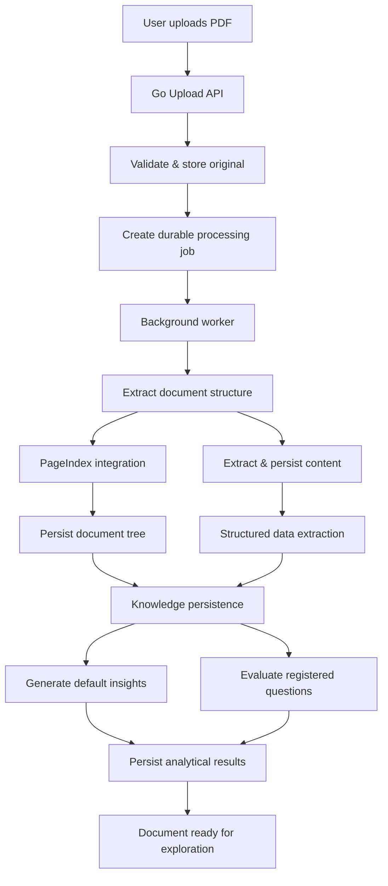

# Pagewise

**From documents to decisions.**

Pagewise is an AI-powered document intelligence platform that turns complex PDFs into durable, searchable, evidence-backed knowledge.

Users upload documents once. The system processes them asynchronously, extracts structured content, generates summaries and insights, evaluates both predefined and user-registered questions, and surfaces everything through a unified search interface that includes charts, excerpts, and direct links back to the original source pages.

The system is built in Go, uses large language models for reasoning, PostgreSQL for durable state, and PageIndex for hierarchical document representation. It explores the intersection of document structure, asynchronous pipelines, and grounded AI reasoning to make dense information actionable without sacrificing traceability.

Initial focus is Human Development Index (HDI) reports. The architecture is deliberately general: it supports financial statements, investment research, regulatory filings, due diligence packages, and other document-heavy analytical workloads.

> **Invariant:** Every claim the system surfaces must be traceable to specific pages in the source documents. Upload once; extract once; reuse forever.

---

## 1. Problem

Critical information is routinely trapped inside long, heterogeneous PDFs that mix narrative, tables, charts, historical series, and methodological notes.

Text extraction alone is insufficient. Analysts still need to:

- Locate the relevant subsets of content
- Correlate findings across sections and time periods
- Validate numerical claims
- Convert scattered facts into reusable conclusions

Traditional PDF viewers leave this work almost entirely to the human. Generic RAG or chat interfaces typically answer one ephemeral question at a time and discard the intermediate knowledge.

Pagewise takes a different stance: **process the document thoroughly once, materialize the resulting knowledge, and keep that knowledge available for continuous exploration and reuse.**

### Capabilities

| Capability | Description |
|---|---|
| Asynchronous processing | Upload returns immediately; heavy work runs in the background |
| Automatic analysis | Summaries, key findings, metrics, and charts generated by default |
| Registered questions | Persist recurring analytical questions and evaluate them against new documents |
| Ad-hoc queries | Natural-language questions answered against the already-extracted knowledge |
| Unified search | Insights, answers, excerpts, and structured data in one interface |
| Visual analytics | Charts derived from validated numerical extractions |
| Evidence links | Every result points back to the originating pages |
| Cross-document (roadmap) | Comparison and aggregation across document collections |

---

## 2. Product Architecture

Pagewise is organized around four tightly coupled capabilities.

### 2.1 Document Ingestion

Users upload PDFs via an API that:

1. Validates the file
2. Stores the original immutably
3. Creates a durable processing job
4. Returns a document ID and current status immediately

The caller never blocks on the full pipeline.

### 2.2 Knowledge Extraction

Background workers drive a multi-stage pipeline:

- Structural parsing and PageIndex tree construction
- Content extraction and persistence
- Entity and numerical data identification
- Durable materialization of the resulting knowledge graph / tree

Once persisted, this knowledge becomes the single source of truth for all downstream consumers (search, questions, charts, future analytics).

### 2.3 Insight Generation

After knowledge is available, the system proactively produces:

- Document-level summaries
- Key findings and important figures
- Trend and comparison signals where data permits
- Answers to a default set of analytical questions
- Charts when sufficient validated numerical series exist

Users may also register their own questions. These are evaluated against any document that satisfies the registration criteria.

### 2.4 Searchable Knowledge

All generated artifacts—insights, answers, excerpts, charts—are indexed and exposed through a single search surface. Users can:

- Discover previously generated insights
- Retrieve prior answers
- Inspect supporting evidence
- Navigate back to the original PDF pages

The explicit goal is that the value extracted from a document outlives the original upload event or any single conversation.

---

## 3. Processing Pipeline



Key design points:

- The upload path is intentionally thin and non-blocking.
- Progress and intermediate state are recorded so that partial work can be observed and recovered.
- Recoverable failures are retried; permanent failures leave the job in a terminal error state with diagnostics.
- Independent analytical stages may execute as soon as their prerequisites are satisfied, improving end-to-end latency.

---

## 4. Getting Started

The project is managed with a `Makefile` that orchestrates local development, testing, and infrastructure.

### Prerequisites

- Go 1.22+
- Docker & Docker Compose
- `make`

### Common Targets

```bash
# Bring up local dependencies (Postgres, etc.) and run the API
make up

# Run the full test suite
make test

# Build all binaries
make build

# Tear everything down and clean volumes
make down

# View logs from the running stack
make logs

# Run database migrations
make migrate

# Generate or regenerate code (mocks, OpenAPI, etc.)
make generate
```

Typical first-time workflow:

```bash
make up          # starts infrastructure + API in development mode
make migrate     # applies schema
# upload a document via the API or UI
make logs        # observe pipeline progress
```

All configuration is driven by environment variables (see `.env.example`). The `Makefile` targets are the supported entry points; direct `go run` or `docker compose` invocations are possible but not the primary interface.

---

## 5. Design Principles

1. **Evidence over eloquence** — Every generated claim must carry a reference to source pages.
2. **Process once, query many** — Heavy extraction and reasoning happen at ingestion time; subsequent interactions are cheap.
3. **Asynchronous by default** — User-facing paths never block on LLM or long-running extraction work.
4. **Durable intermediate state** — Jobs, partial extractions, and knowledge artifacts survive restarts.
5. **General architecture, specific first vertical** — HDI reports are the initial domain; the core model is domain-agnostic.

---

## License

Copyright © 2026
